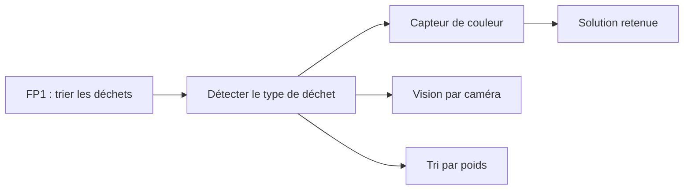

# Études et choix techniques

{: .a_supprimer }
> Le cahier des charges dit *quoi* faire, cette page explique *comment* et **pourquoi** :
> d'abord ce qui existe déjà, puis les tests rapides, puis les choix retenus.
> Si vous avez beaucoup de choix à documenter, faites une sous-page par choix
> (ajoutez `has_children: true` ici et `parent: Études et choix techniques` dans les sous-pages).

## Recherche de l'existant

{: .a_modifier }
> Projets du MakerSpace des années précédentes, projets en ligne (Hackaday,
> Instructables, GitHub…), produits du commerce : qu'est-ce qui fait déjà quelque
> chose de proche, et qu'est-ce que vous en retenez ? Citez vos sources.
> Voir [Rechercher l'existant et étudier la faisabilité](https://doc.makerspace-amiens.fr/workshops/methodologie-de-projet/concepts/rechercher-existant-faisabilite/).

### Comparaison des architectures de machine

| Solution étudiée | Source | Avantages | Inconvénients | Ce qu'on retient |
|---|---|---|---|---|
| Machine à axes cartésiens (X et Y séparés) | [Projet Groupe 03](https://makerspace-amiens-2025-26.github.io/MachineThatDraws-Groupe03/), [Groupe 09](https://makerspace-amiens-2025-26.github.io/MachineThatDraws-Groupe09/), [3D Printed Arduino CNC Plotter](http://www.youtube.com/watch?v=XYqx5wg4oLU) | Conception simple, fonctionnelle et facile à mettre en place ; nombreux tutoriels (Arduino, GRBL, NEMA 17) | Basique, peu originale, moins rapide | **Retenue** : probablement le meilleur choix |
| Machine à corps X-Y (CoreXY) | [Tutoriel LetMeKnow](https://letmeknow.fr/fr/blog/110-tuto-piloter-une-cnc-avec-arduino-et-grbl), [Guide AranaCorp](https://www.aranacorp.com/fr/controler-une-cnc-avec-lasergrbl-et-un-shield-cnc/) | Plus rapide | Complexe, nécessite une grande précision | Écartée : trop compliquée |
| Machine à bras articulé (SCARA) | Projet Groupe 07 (2025-26), [lien](https://makerspace-amiens-2025-26.github.io/MachineThatDraws-Groupe07/) | Moins de pièces | Très complexe à mettre en œuvre, grande précision requise au point de pivot, forte inertie | Écartée pour ce projet |
| Traceur à stylo suspendu (mural) | [Suspended Pen XY Plotter](http://www.youtube.com/watch?v=yd0BQS4SESk) | Grande surface de dessin | Précision moindre, installation murale nécessaire | Écartée : ne correspond pas à notre cahier des charges |
| Mini machine à moteurs de lecteurs CD/DVD | [Mini Arduino CNC Drawing Machine](http://www.youtube.com/watch?v=e7T7eLR0t_E) | Récupération de matériel, compacte, peu chère | Course très réduite | Intéressant pour le principe, pas pour la taille |
| Robot avec changeur automatique de stylos (8 stylos) | [Drawing Robot Pen Changer](http://www.youtube.com/watch?v=J4rVkgPuZJk) | Dessin multicolore sans intervention | Mécanique et contrôleur plus complexes | Option d'amélioration possible, pas prioritaire |

### Sous-système : lever et baisser le stylo (servomoteur)

| Solution étudiée | Source | Avantages | Inconvénients | Ce qu'on retient |
|---|---|---|---|---|
| Pales + ressort | [Vidéo YouTube (à 8:05)](https://www.youtube.com/watch?v=CW3tCkms7oM) | Facile à utiliser et à comprendre | Structure à lever à garder légère, sinon risque de casser le servomoteur | À comparer |
| Roue crantée + bande crantée | Idée de l'équipe | Facile à utiliser et à comprendre | Même risque si la structure est trop lourde | À comparer |
| Levier | Schéma de l'équipe | Meilleure précision (à vérifier) | Un peu plus difficile à comprendre ; risque de blocage si mal réglé | À comparer |

### Sous-système : génération du G-code

| Solution étudiée | Source | Avantages | Inconvénients | Ce qu'on retient |
|---|---|---|---|---|
| Universal G-code Sender | [GitHub](https://github.com/winder/Universal-G-Code-Sender/releases) | Compatible Windows, macOS et Linux ; envoie et génère du G-code pour dessiner | Prise en main du logiciel | Retenu pour l'envoi du G-code |
| G-code Art Generator | [Site](https://carlobalde-lang.github.io/gcode-art-generator/) | Transforme une image en G-code | Conçu pour l'impression 3D ; réutilisation pour le dessin incertaine | À tester |
| Générateur maison (V0.1 / V0.2) | [V0.1](/MachineThatDraws2627-Groupe06/assets/site_externe/index.html), [V0.2](/MachineThatDraws2627-Groupe06/assets/site_externe/index2.html#gcode) | Adapté à notre besoin, avec options | Encore en développement | Piste principale |

## Pré-étude de faisabilité

Avant de valider nos choix, nous voulons vérifier trois points qui nous inquiètent le plus.

| Test | Pourquoi | Comment on le teste | Critère de réussite |
|---|---|---|---|
| **Stabilité du relevage du stylo** | Vérifier que le stylo se lève et se baisse sans saccades, ce qui abîmerait le dessin | Monter chaque solution (pales + ressort, courroie crantée, levier) et faire répéter 50 à 100 lever/baisser, en observant les à-coups et le point de contact sur la feuille | Mouvement fluide, pas de point ou de trait parasite à la reprise du tracé, servomoteur qui ne force pas |
| **Vibrations de la machine** | Les moteurs et les va-et-vient des axes peuvent faire trembler le tracé | Tracer des lignes droites, des carrés et des cercles à plusieurs vitesses, puis regarder si les traits sont ondulés ou doublés | Traits droits et nets à la vitesse choisie ; pas de desserrage des vis après plusieurs tracés |
| **Complexité et coordination des axes** | Faire travailler X, Y et le levage ensemble sans décalage | Envoyer d'abord un G-code simple (carré, diagonale), puis un dessin complet, et mesurer l'écart entre le dessin attendu et le dessin obtenu | Les formes se ferment correctement (le tracé revient au point de départ) et les diagonales sont régulières |

{: .touche_perso }
> Notre plus grosse crainte est la vibration de la machine, ainsi que la complexité de l'axe et la coordination de tous les axes entre eux. Ce sont ces tests qui décideront de la solution de levage du stylo retenue.

## Choix techniques

{: .a_modifier }
> Pour chaque choix difficile à remettre en cause (composant central, architecture,
> procédé de fabrication), répondez aux quatre questions ci-dessous. Appuyez-vous
> sur des arguments **techniques** : résultats de tests, performances, contraintes
> du cahier des charges.
> Voir [Tracer ses choix techniques](https://doc.makerspace-amiens.fr/workshops/methodologie-de-projet/concepts/tracer-choix-techniques/).

Attendre d'avoir aussi des test et prototype pour regler certain probleme que le ne peux pas resoudre sans test

Un diagramme **FAST** aide à passer d'une fonction du cahier des charges aux
solutions possibles :

### Choix : titre du choix

**Contexte :** …

**Options envisagées :** …

**Choix retenu et pourquoi :** …

**Compromis acceptés :** …
