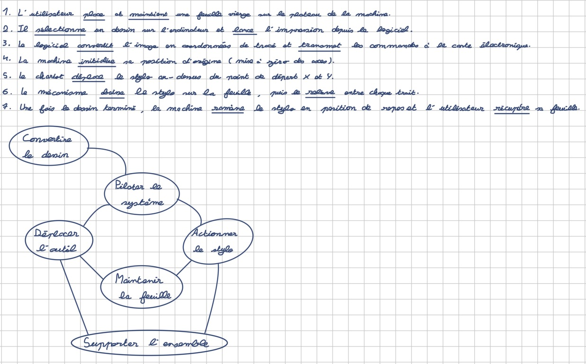

# Scénario d'usage et schéma bloc

**Séance :** en créneau • **Durée :** 1 h 30 min

## Fait

Au cours de cette séance, j'ai formalisé l'analyse fonctionnelle complète de notre machine à dessiner sur feuille puis je l'ai intégrée au dépôt GitHub :

1. **Rédaction du scénario d'usage en 7 étapes :** Description chronologique du fonctionnement de la machine (mise en place de la feuille, sélection et conversion du dessin, initialisation des axes, déplacement X/Y, abaissement/levée du stylo et récupération du tracé final) avec mise en évidence des verbes d'action.
2. **Structuration en 6 blocs fonctionnels :**
   * *Convertir le dessin*
   * *Piloter le système*
   * *Déplacer l'outil*
   * *Actionner le stylo*
   * *Maintenir la feuille*
   * *Supporter l'ensemble*
3. **Création du schéma bloc :** Représentation graphique des interactions et des liens entre les différents sous-systèmes.
4. **Intégration sur GitHub :** Numérisation et ajout de la photo de mon travail dans le dossier `assets/images/Louis/` du dépôt.

## Pourquoi

Cette étape d'analyse fonctionnelle permet de clarifier précisément le rôle de chaque sous-système ainsi que les interfaces entre eux (notamment entre le déplacement de l'outil et l'actionnement du stylo) avant d'entamer la conception mécanique détaillée.

## Reste à faire

Valider les dimensions et les points de fixation des interfaces avec l'équipe, puis démarrer la modélisation CAO 3D du sous-système porte-stylo.